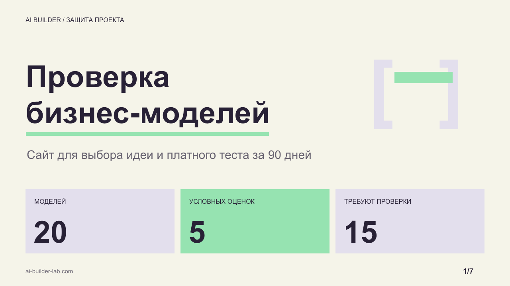
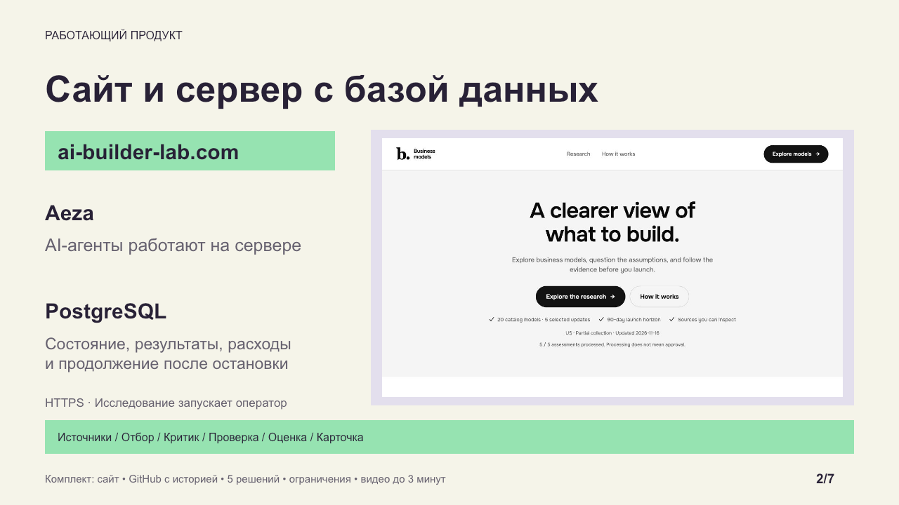
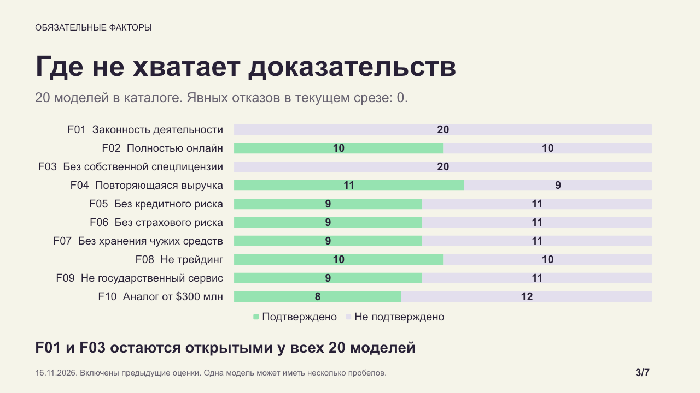
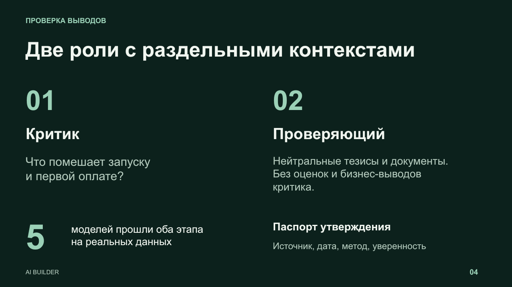
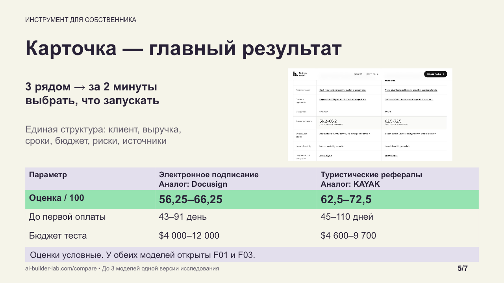
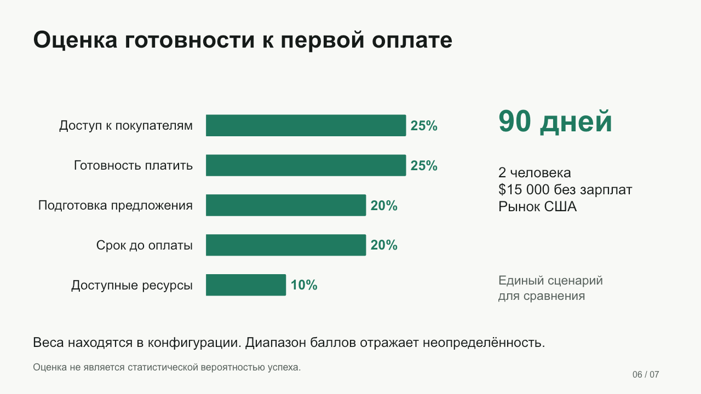
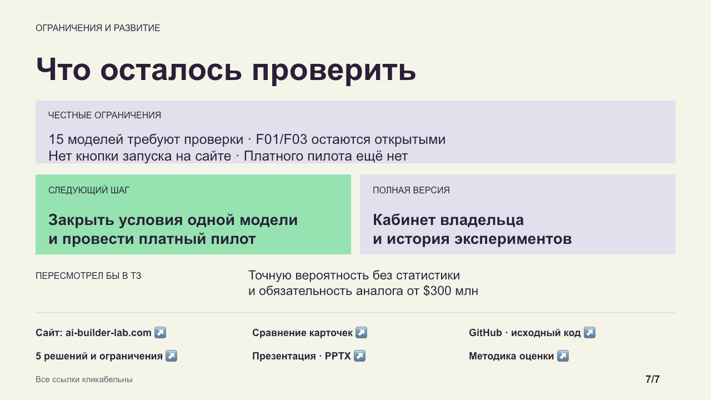

# AI Builder: защита тестового задания

[Скачать презентацию PPTX](AI-Builder-CEO.pptx) · [Открыть сайт](https://ai-builder-lab.com/)

Семь слайдов для CEO, формат 16:9. Таблица и обе диаграммы редактируются в PowerPoint, данные диаграмм встроены в файл.

## Оформление

Композиция адаптирована по [The Pitch от Gamma](https://gamma.app/ru/templates/the-pitch): единый тёплый светлый фон, мятный акцент, светло-сиреневые блоки, крупные заголовки и тонкие разделители. Все семь слайдов и данные сохранены; диаграммы и таблица остаются редактируемыми.

## Опорные пункты защиты

- Слайд 2: сайт и комплект сдачи; видео обозначено как формат защиты.
- Слайд 4: решения при сбое LLM и противоречии в источниках.
- Слайд 5: карточка как главный результат, единая структура, сравнение трёх моделей и выбор собственника.
- Слайд 6: веса и причина приоритета клиента и спроса.
- Слайд 7: честные ограничения, платный пилот, полная версия, пересмотр ТЗ и шесть кликабельных ссылок.

[Короткий файл: пять решений, альтернативы и актуальные ограничения](decisions.md).

## Факты и границы результата

Срез опубликованных данных на 16 ноября 2026 года: 20 бизнес-моделей, 5 условных оценок, 15 моделей требуют проверки. Все пять оценённых моделей завершили этапы Critic и Verifier. Условная оценка сохраняет открытые условия запуска и не означает юридического допуска или гарантии первой оплаты.

Диаграмма F01–F10 показывает `pass` и `unknown` по текущим карточкам каталога, включая сохранённые оценки предыдущего исследования. Явных `fail` в этом срезе нет. Неизвестность не считается отказом. Для каждого фактора сумма составляет 20; складывать пробелы разных факторов в число моделей нельзя.

Компании Docusign и KAYAK представлены как аналоги предлагаемых моделей. Сроки, баллы и бюджеты являются аналитическими оценками. Сайт позволяет сравнивать до трёх моделей в совместимой версии исследования. Серверное исследование запускает оператор, публичный сайт показывает результаты.

## Источники

- [Публичные результаты](https://ai-builder-lab.com/runs/1394ce6bcce54e07aa9eb8c9d3c81106?format=json)
- Ревизия: `recovery-3cb641b6a0950f862d7ac33ecc9d1d3a`
- Публикация данных: `2026-11-16T11:45:49.412685+00:00`
- SHA-256 исходного публичного JSON: `d57a96c421d8c8725ff00f704b39fb8aca2da82a610cf9ed90b49c9550e7a461`
- [Конфигурация факторов и весов](../config/conditional-config.json)
- [Описание серверного развёртывания](../docs/deployment.md)
- [Спецификация рейтинга](../specs/07-ranking.md)
- [Правила условных оценок](../specs/15-conditional-scoring.md)
- `data.json` содержит использованную выборку публичных чисел и завершённых этапов.
- `assets/` содержит снимки опубликованного сайта и архивную концептуальную иллюстрацию, которая не используется в текущем оформлении. Описание и промпт иллюстрации находятся в [assets/README.md](assets/README.md). В презентации нет закрытых журналов, ключей или дампов базы данных.

## Сборка

`build.mjs` создаёт черновик PPTX, PNG слайдов из зафиксированных данных и снимков сайта. Нужны Node.js, доступный модуль `@oai/artifact-tool` из среды Codex и шрифт Arial.

```sh
node presentation/build.mjs /tmp/ai-builder-deck
```

Готовый проверенный файл находится здесь в `AI-Builder-CEO.pptx`. Черновик сборщика сохраняется отдельно; при обновлении перед заменой готового файла необходимо повторно проверить диаграммы, встроенные данные и вид всех слайдов.

## Просмотр слайдов














